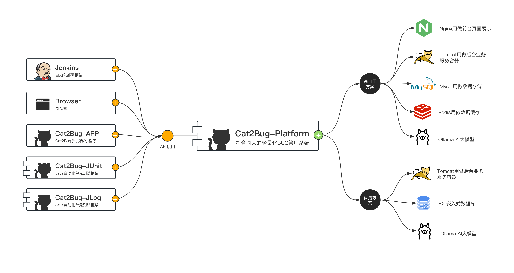
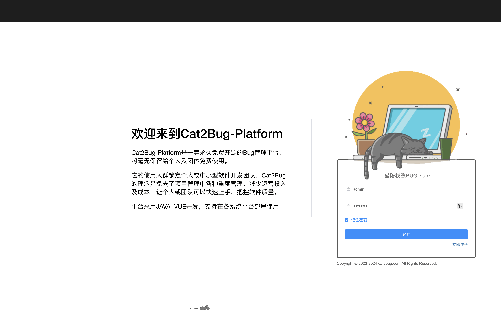
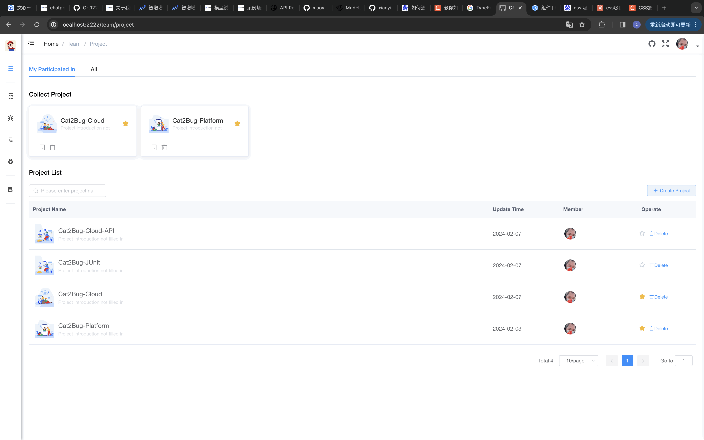
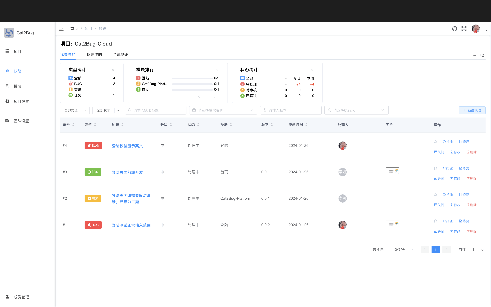
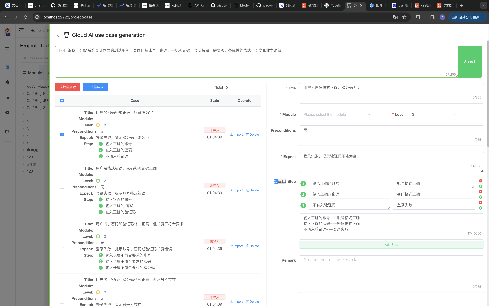
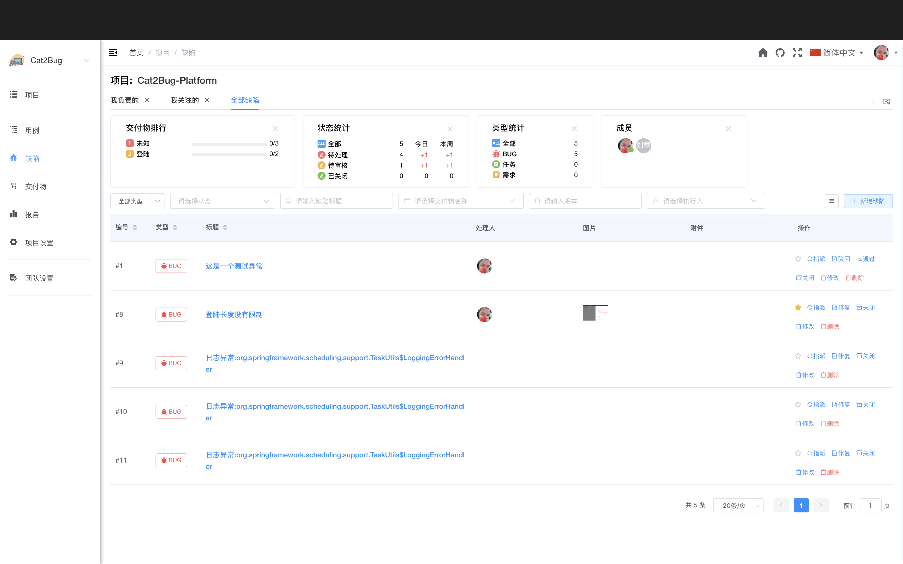
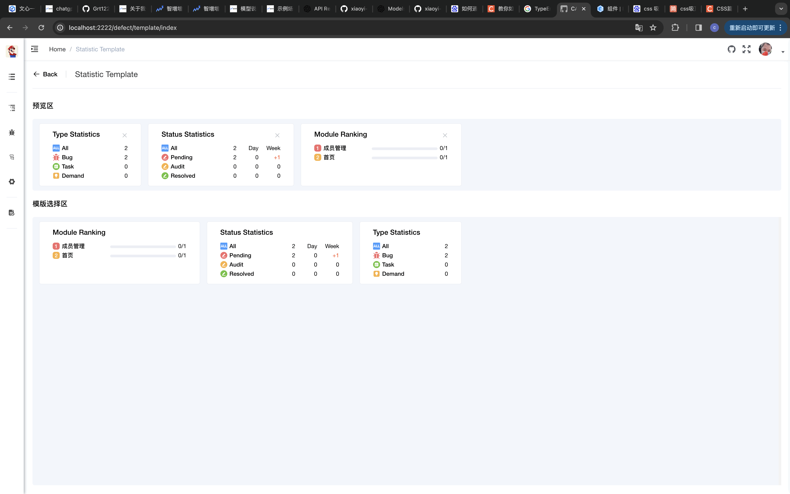
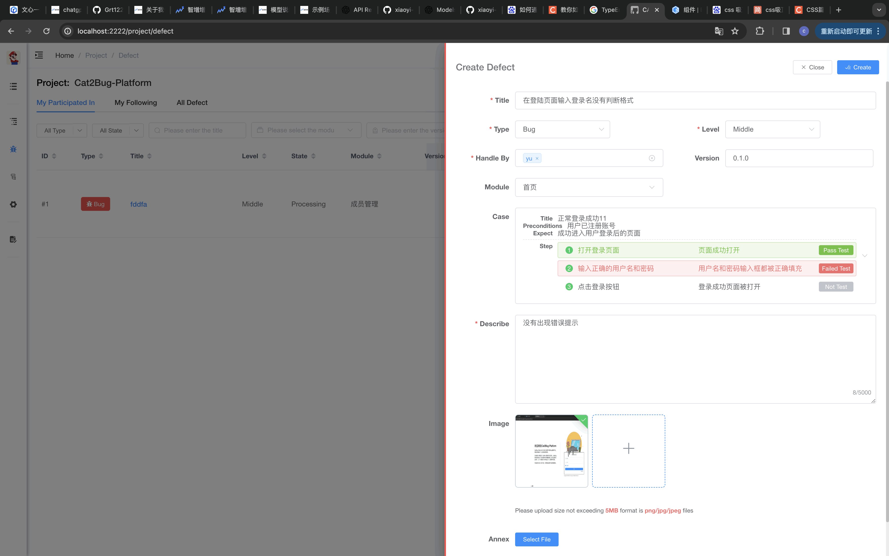
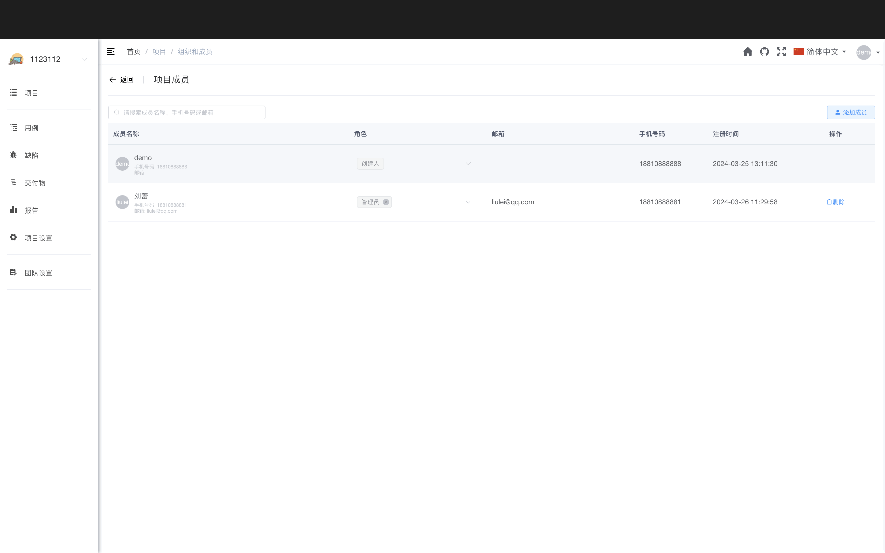

<div align="center">
  <!-- 与登录页 CatIllustration 同源（login-cat-scene-light/dark.jpg） -->
  
</div>
<h1 align="center" style="margin: 30px 0 30px; font-weight: bold;">Cat2Bug-Platform v1.1.0</h1>
<h4 align="center">轻量化智能BUG管理平台</h4>

## 平台简介

Cat2Bug-Platform是一套永久免费开源的Bug管理平台，可以完全私有化部署，它利用目前比较流行的AI大数据模型技术作为辅助，快速提升软件管理的质量，我们将毫无保留给个人及团体免费使用。
它的使用人群锁定个人或中小型软件开发团队，Cat2Bug的理念是免去了项目管理中各种重度管理，让个人或团队可以快速上手，把控软件质量。
平台采用JAVA+VUE前后台分离模式开发，支持在各系统平台部署使用。

## 内置功能

1.  仪表盘：统计缺陷、成员、计划信息。
2.  团队管理：管理团队中的项目、成员。
3.  项目管理：管理项目中的缺陷、成员。
4.  用例管理：管理测试用例。
5.  缺陷管理：管理BUG、需求、任务。
6.  交付物管理：维护项目中的可交付物品。
7.  报告管理：显示团队、项目、测试用例、缺陷、交付物等的相关数据指标。
8.  API管理：用于管理API接口密钥
9. 通知管理：发送系统业务通知到系统内部、邮件、钉钉等平台中。
10. 安装向导：一站式图形化安装配置，引导用户完成数据库、缓存、文件存储、AI及初始管理员账号的设置。

## 最新版本更新说明

当前最新版本是1.1.0

**运行时要求（1.1.0 后端）**：构建与运行需 **JDK 17+**。**产品默认后端为 Quarkus**（Maven `-Pquarkus`）；Spring Boot admin 仅作对照 / 紧急回滚。Maven 版本号为 1.1.0。详见 [CHANGELOG.md](CHANGELOG.md)；Spring 栈说明见 [docs/backend-spring-boot-3.md](docs/backend-spring-boot-3.md)。

* 添加系统快捷键体系
* 缺陷 Excel 暗色主题与 Safari 行号列滚动体验优化
* 安装向导补充 H2 旧版数据库文件格式不兼容提示

## 特色

* 开源私有化AI+BUG系统部署;
* 通过AI技术自动生成测试用例并录入到系统，解决费时费力录入用例的痛点;
* 已测试平台为生态中心，衍生多种缺陷监控测试框架，可以一站式解决软件生产运维中的诸多痛点；
* 自主研发报告模版，可轻松、快速、动态的生成项目所需管理及交付文档，较免管理人员编写文档的时间成本;
* 专注于软件的缺陷的跟踪管理，简单直接，即开即用，减少学习成本；

## 在线体验

- 体验账号：demo
- 体验密码：123456

演示地址：[https://www.cat2bug.com:8022](https://www.cat2bug.com:8022)

## 关联产品

| 名称                                                         | 类型          | 说明                                                                |
|------------------------------------------------------------|-------------|:------------------------------------------------------------------|
| [Cat2Bug-App](https://gitee.com/cat2bug/cat2bug-app)       | 缺陷管理手机端     | Cat2Bug-Platform平台的手机端系统                                          |
| [Cat2Bug-Chrome](https://gitee.com/cat2bug/cat2bug-chrome) | 缺陷管理谷歌浏览器插件 | Cat2Bug-Platform平台的谷歌浏览器插件                                        |
| [Cat2Bug-MCP](https://gitee.com/cat2bug/cat2bug-mcp)       | MCP代理服务     | Cat2Bug-Platform与AI大模型通讯代理服务                                      |
| [Cat2Bug-JLog](https://gitee.com/cat2bug/cat2bug-jlog)     | 错误日志采集框架    | 获取项目中的异常日志，并将日志报告提交到Cat2Bug-Platform                              |
| [Cat2Bug-JUnit](https://gitee.com/cat2bug/cat2bug-junit)   | 单元测试框架      | 自动化单元测试框架，目前可以自动扫描Controller接口，随机提供参数测试，并将测试报告提交到Cat2Bug-Platform |

## 系统架构



## 技术选型

1. 系统环境

* Java 17
* Jakarta Servlet 6
* Apache Maven 3

2. 主框架

* Spring Boot 3.3.x
* Spring Framework 6.x
* Spring Security 6.x

3. 持久层

* Apache MyBatis 3.5.x
* Hibernate Validation 6.0.x
* Alibaba Druid 1.2.x

4. 视图层

* Vue 3.5 + Vite 6
* Pinia 2 + Vue Router 4
* Element Plus 2.9
* Axios 1.7.x
* vue-i18n 9（7 语言）

## 模块

````
--cat2bug-platform
------|----cat2bug-platform-admin       # 主程序模块
------|----cat2bug-platform-ai          # 人工智能模块
------|----cat2bug-platform-im          # 通讯模块
------|----cat2bug-platform-api         # Open API模块
------|----cat2bug-platform-common      # 通用模块
------|----cat2bug-platform-framework   # 系统框架
------|----cat2bug-platform-generator   # 代码生成
------|----cat2bug-platform-quartz      # 定时任务
------|----cat2bug-platform-system      # 业务模块
------|----cat2bug-platform-ui          # 前端VUE工程
------|----deploy                       # 部署相关文件
------|----sql                          # 数据库文件
------|----readme                       # 文档
--------------|----development          # 项目开发文档
--------------|----production           # 生成环境使用文档
````

## 部署

### 默认后端（Quarkus，推荐）

需 **Java 17+**。日常开发与 JVM 发布以 Quarkus admin 为准（`-Pquarkus`）。模块说明见 [cat2bug-platform-admin/README.md](cat2bug-platform-admin/README.md)；本地配置见 `openspec/changes/restore-quarkus-full-delivery/LOCAL-RUN.md`。

```bash
# 开发（推荐）
./cat2bug-platform-admin/dev.sh
# 或
mvn -pl cat2bug-platform-admin -am quarkus:dev

# 打包 / 运行 JVM JAR
mvn -pl cat2bug-platform-admin -am package -DskipTests
./deploy/run-jar.sh

# 嵌入式前端 + Quarkus JAR
./deploy/build-embedded.sh
./deploy/run-jar.sh
```

前端独立开发仍可：`cd cat2bug-platform-ui && npm run dev`（代理到 `:2020`）。

Quarkus Native（约 20MB，默认按 UPX 后计）为 **Gate B**，须在 JVM 功能验收（Gate A）通过后再做；门禁说明见 `openspec/changes/restore-quarkus-full-delivery/GATE-NOTES.md`。

### Spring Boot admin（对照 / 紧急回滚，非推荐）

以下命令**保留但不作为产品默认路径**，仅用于对照现网行为或紧急回滚。

**JVM：**

```bash
# 开发
mvn spring-boot:run -pl cat2bug-platform-admin
# 使用 MySQL
mvn spring-boot:run -pl cat2bug-platform-admin -Dspring-boot.run.profiles=mysql

# 打包运行
mvn -pl cat2bug-platform-admin -am package -DskipTests
java -jar cat2bug-platform-admin/target/cat2bug-admin.jar
```

**Spring Native（对照，非推荐默认 Release）：** 无需 JRE，单文件 Native ELF（含 embedded Vue SPA）。见 [readme/spring-native-delivery/README.md](readme/spring-native-delivery/README.md)。

```bash
./deploy/build-native-spring.sh x86_64
PORT=2020 ./deploy/docker/run-native-spring-minimal.sh run-bg debian
./deploy/test/native-api-smoke.sh http://127.0.0.1:2020
```

**手动批处理（Spring JVM JAR）：** 将 `deploy` 目录中的 `cat2bug-service.sh` / `cat2bug-service.bat` 与 `cat2bug-admin.jar` 拷到同一目录后执行：

```shell
cat2bug-service.sh start   # 启动
cat2bug-service.sh stop    # 停止
cat2bug-service.sh status  # 状态
```

### Docker单容器部署

以下提供的是Docker官网容器化的部署方案，执行命令如下：

```docker
docker run -it -d -p 8022:8022 --name cat2bug-platform docker.cat2bug.com/cat2bug/cat2bug-platform/single:latest
```

### 本地通过Docker-Compose容器化部署

将后台服务./cat2bug-platform-admin/target/cat2bug-admin.jar、前台打包后的文件夹./cat2bug-platform-admin/src/main/resources/static、数据库sql文件./data/cat2bug_platform.sql拷贝到./deploy/docker目录下，执行以下命令：

```shell
docker-compose up -d
```

部署成功后，打开浏览器访问 [http://127.0.0.1:8022](http://127.0.0.1:8022)，系统在首次启动时会引导至 **图形化首次安装向导 (`/setup`)**：

*   **配置向导**：支持可视化完成数据库（嵌入式 H2 或 MySQL）、缓存（Caffeine 或 Redis）、文件存储路径、Ollama AI 机器人以及超级管理员账号等配置。
*   **重启生效**：提交配置后，**需要重启系统进程**，使新的数据源和系统运行配置完全生效。重启后即可使用您刚刚在向导中设置的超级管理员账号进行登录。
*   **默认/推荐账号**：系统管理员默认建议为 `admin`，密码为 `cat2bug`（可在向导中进行自定义修改）。
*   **静默/自动部署**：若通过 Docker 或 CI/CD 自动部署且需要跳过配置向导，可在启动前配置环境变量 `CAT2BUG_INSTALL_SKIP=true`，系统将直接跳过向导并以默认 H2 配置启动。

此部署方式为单容器最精简方式部署，如需多容器分布式或复杂生产环境部署方案，请查看 [系统使用文档中的管理员指南](readme/production/admin-guide/install-wizard.md) 或 [官网文档](https://www.cat2bug.com/download/cat2bug-platform/#%E9%83%A8%E7%BD%B2)。

## 演示图

<table>
    <tr>
        <td></td>
        <td></td>
    </tr>
    <tr>
        <td></td>
        <td></td>
    </tr>
    <tr>
        <td></td>
        <td></td>
    </tr>
    <tr>
        <td></td>
        <td></td>
    </tr>
</table>

## 未来计划

目前Cat2Bug还在持续成长中，后续我们将在测试工具、自动化、AI几个方向持续投入，完善平台的功能。2026计划如下：

* cat2bug-platform: 功能叠加，完善系统统计管理功能；
* cat2bug-app：完善移动端APP；
* cat2bug-cloud：cat2bug云平台的建设；

## Cat2Bug交流群

| QQ群： [731462000](https://qm.qq.com/cgi-bin/qm/qr?k=G_vJa478flcFo_1ohJxNYD0mRKafQ7I1&jump_from=webapi&authKey=EL0KrLpnjYWqNN9YXTVksNlNFrV9DHYyPMx2RVOhXqLzfnmc+Oz8oQ38aBOGx90t) | 微信群：Cat2Bug                                                                 |
|--------------------------------------------------------------------------------------------------------------------------------------------------------------------------------|-----------------------------------------------------------------------------|
|                                                                   |  |
