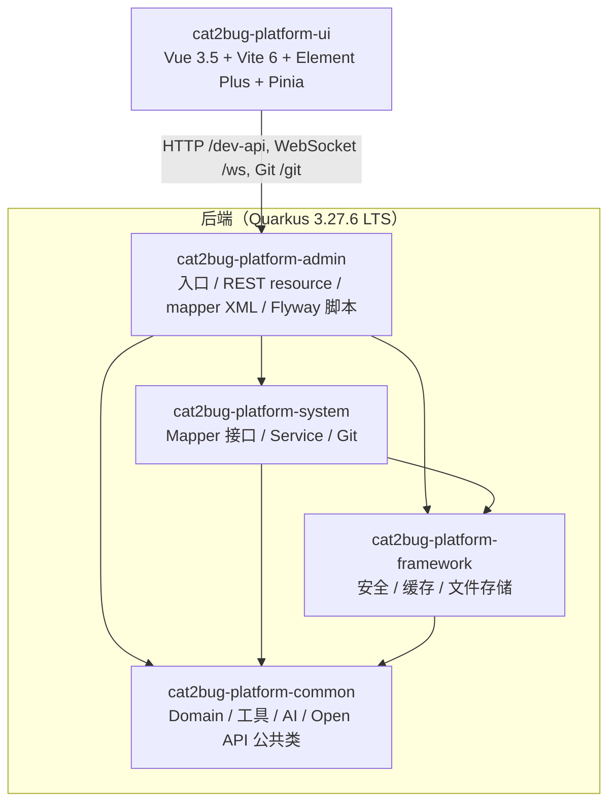

# 整体架构

本篇说明 Cat2Bug-Platform 1.1.0 的模块组成、前后端交互方式以及认证、缓存、WebSocket 等横切机制。

## 模块关系

仓库只有一套后端（Quarkus 3.27.6 LTS）。根 `pom.xml` 默认 `<modules>` 就是下面四个模块，`mvn package` 无需任何 profile 即构建产品（见 [[ADR-010-移除Spring后端并统一模块命名]]）。

- 依赖关系取自各模块 `pom.xml`；artifactId 为 `cat2bug-{admin,system,framework,common}`，Java 包根为 `com.cat2bug.{admin,system,framework,common}`，`quarkus.application.name=cat2bug-admin`。
- 原 Spring Boot 线（`admin/framework/system/common/api/ai/im/quartz/generator` 九个模块）已于 2026-10-14 删除，删前最后状态留在本地 tag `spring-final-1.1.0`。其 api / ai / quartz 能力早已合并进上述四个模块（如 `cat2bug-platform-common` 下的 `ai`、`open` 包，定时任务用 `quarkus-scheduler` + `sys_job` 编程式注册）；im 的缺陷 / 通知 / 报告新建推送到站内、钉钉、飞书、企业微信和邮件已由 OpenSpec 变更 `restore-im-external-push` 补齐，见 [[IM多渠道推送]]；XSS 过滤、`@DataScope` 数据权限、Ollama 启动拉默认模型、用例提示词导出四项已由变更 `close-spring-parity-gaps` 补齐（XSS 改为前端渲染时清洗，见 [[ADR-012-用户内容在前端渲染时清洗而非后端转义]]；数据权限见 [[权限模型与鉴权链路]]）；代码生成器 `/tool/gen` 与若依示例 `test/user` 随 Spring 线永久移除。
- `-Prelease` 产物为 `cat2bug-platform-admin/target/cat2bug-admin.jar`（uber-jar），见 [[部署]]。
- 交付分两道关：Gate A（JVM 功能验收）→ Gate B（Native），见 [[ADR-004-Native交付分两道门并接受约38MiB]] 与 `openspec/changes/archive/2026-10-14-restore-quarkus-full-delivery/GATE-NOTES.md`。

## 前后端交互

- 后端端口 2020（`quarkus.http.port=2020`）。
- 前端 dev 端口 2222，`vite.config.js` 代理：
  - `/dev-api` → `http://127.0.0.1:2020`（去前缀）
  - `/ws` → `ws://127.0.0.1:2020`（WebSocket，去前缀）
  - `/git` 与 `/{teamKey}/{projectKey}/code/{slug}.git` → 后端（Git Smart HTTP，关闭超时）
  - `/file-view` → `ws://localhost:8012`（文件预览服务，用途待确认）
- 构建模式（`cat2bug-platform-ui/package.json`）：
  - `build:embedded` → 输出到 `cat2bug-platform-admin/src/main/resources/META-INF/resources`，由后端内嵌提供；`EmbeddedSpaFallbackFilter` 处理 history 路由回退。
  - `build:prod` → `dist/`，供 Docker Compose 的 nginx 前端镜像使用。
- 统一响应体 `AjaxResult`（`code`/`msg`/`data`）。

## 认证

实现位于 `cat2bug-platform-framework/.../framework/security/`：

| 机制 | 适用路径 | 实现要点 |
|---|---|---|
| JWT | 常规接口 | `JwtAuthFilter`（JAX-RS `@Priority(AUTHENTICATION)`），`TokenService` 解析 `Authorization: Bearer ...`；有效期 `cat2bug.token.expire-minutes=240`；会话由 `SessionStore` 保存；权限由 `PermissionAuthorizationFilter` + `@RequiresPermissions` 校验；白名单见 `PublicPaths` |
| API Key | `/api` 与 `/api/**`（`OpenApiPaths`） | `ApiKeyAuthFilter` 读请求头 `CAT2BUG-API-KEY`（兼容 `Bearer ` 前缀）；`ApiFeaturePermissionFilter` 按项目启用的功能放行；开关 `cat2bug.api.enabled` |
| Git Smart HTTP Basic | `git/p/{projectId}/{slug}.git/**`（旧）与 `{teamKey}/{projectKey}/code/{slug}.git/**` | JWT 过滤器跳过（`GitSmartHttpPathSupport`），`GitSmartHttpResource` 自行做 HTTP Basic（realm `Cat2Bug Git`） |

JWT 签名密钥配置项为 `cat2bug.token.secret`，生产须在安装配置中覆盖（不要使用仓库内默认值）。

## 缓存与会话

- 应用缓存 `AppCacheStore`：`cat2bug.cache.type=local|redis`，redis 时需 `cat2bug.redis.hosts`，键格式 `region:key`（沿用原 Spring J2Cache generic 区域命名）。
- 会话 `SessionStore`：`cat2bug.session.store=memory|redis`。
- 默认均为本地内存；多实例部署需切到 Redis。

## WebSocket

- 端点 `/websocket/{memberId}/message`；实现为 `MessageWebsocketEndpoint`（`jakarta.websocket` `@ServerEndpoint`）。
- 前端 dev 通过 `/ws` 前缀代理；embedded 模式 `VUE_APP_BASE_WEBSOCKET` 为空，直连同源。

## 相关笔记

[[数据库]] · [[部署]] · [[存储与Git仓库]]

返回 [[说明]]
